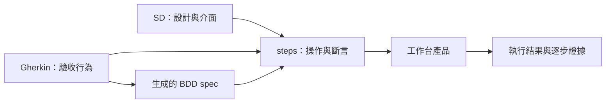

# BDD 工作台

專案以 [Gherkin](spec/REQ-WB-001/workbench/workbench.feature) 定義驗收行為，以 [SD](spec/REQ-WB-001/workbench/workbench.sd.md) 定義實作設計。`playwright-bdd` 將 Gherkin 轉成 Playwright spec；spec 呼叫 [steps](spec/REQ-WB-001/workbench/workbench.steps.ts) 中的實際操作與斷言。

```text
spec/REQ-WB-001/
  review.json                需求文件的目前確認與 hash
  workbench/
    workbench.feature          驗收條件：28 個 Scenario、44 個案例
    workbench.sd.md            此 Gherkin 專屬設計與測試契約
    workbench.steps.ts         Given / When / Then 操作與斷言
    workbench.feature.spec.ts  從此 Gherkin 生成的 Playwright spec
    testing/
      support/                 此功能的 DB、瀏覽器與證據接線
      fixtures/                此功能驗收所需的被測輸入
test-results/bdd/          最新生成 manifest、中間檔與檢查結果（忽略提交）
tools/                    建置、啟動驗收環境與程式檢查腳本
  bdd/                    BDD 生成、映射檢核與執行入口
tests/unit/               程式單元測試
tests/integration/        元件、HTTP 與工具整合測試
src/                      工作台後端程式
ui/                       Vue 前端
package.json              全專案依賴與執行入口
dist/                     後端、前端與測試編譯產物（忽略提交）
```



同一需求有多個 Gherkin 時，在需求目錄內各建一個功能目錄，讓同名 `.feature`、`.sd.md`、`.steps.ts`、`.feature.spec.ts` 相鄰。生成 spec 由工具管理；BDD 設定載入 steps，spec 透過框架的步驟註冊呼叫其中實作。修改產品看 `src/` 與 `ui/`。

## 啟動

在專案根目錄：

```bash
npm ci
npm run build
npm start
```

服務只監聽雲端 `127.0.0.1:4173`，`GET /health` 可檢查。`127.0.0.1` 指執行服務的主機。使用平台提供的連接埠轉送時仍應保留私有存取；這個版本沒有另加 SD 明確排除的 ACL 子系統，不應直接把 shell/API port 公開。

安裝需要 Node headers 與原生編譯工具。`postinstall` 使用 node-pty 官方支援的 source build，避免發行預編譯 helper 缺執行權限；npm 的 lifecycle 許可僅針對鎖定的 node-pty 版本。build 使用根目錄依賴，後端與測試輸出至 `dist/`，前端輸出至 `dist/public/`。

預設 metadata：`.workbench/metadata.sqlite`；執行／圖片／暫存工作區：`.workbench/`。新建 metadata 由真實 SQLite worker migration 初始化；既有不相容資料庫會拒絕啟動，不清空使用者資料。瀏覽器不在安裝或啟動服務時自動下載。

## 部署 SQL

```bash
npm run deploy
node deploy/migrate.mjs /absolute/path/metadata.sqlite
# 已有資料庫且需要升級時，必須指定新的備份路徑：
node deploy/migrate.mjs /absolute/path/metadata.sqlite --backup /absolute/path/before-migration.sqlite
```

`deploy/` 由 canonical schema／migration registry 產生，包含 DDL、完整 migration SQL、來源與產物 hash，以及執行器。只有真正需要 seed／backfill 的 migration 才產生部署 DML；沒有初始化資料時 manifest 明載原因。產物不人工維護、不包含測試資料或密碼。詳細規格見專屬 SD §7.5。

## 專用驗收環境

```bash
npm run init-fixtures
npm run serve-fixtures
# 另開terminal
npm run test:e2e
```

初始化只建立 repo 內 `.test-fixtures/` 的專用 metadata、target DB、target Git。測試網站是真實的 A/B 登入、SQLite 文件持久化及管理拒絕；它不是假工作台或成功回應 mock。既有 fixture 不重設，重跑可指定新的專用 fixture 目錄；請勿刪除使用者資料。

測試工作台位於 `http://127.0.0.1:4310`，目標網站 `http://127.0.0.1:4311`。fixture 密碼與環境檔保存在 `.test-fixtures/target-password`、`.test-fixtures/product.env`，權限 0600，未加入 Git；不會印出密碼。

`test:e2e` 先以 `chromiumSandbox:true` 真正檢查 browser 是否可啟動，再檢查 provider 與服務；缺條件即 exit 2／NOT_RUN，不啟動 44 案或改成 skip。條件足夠時才呼叫既有 `tools/bdd/run-e2e.mjs`，仍受原 manifest、固定集合與證據 reporter 檢查。正式 E2E 輸出仍由既有 runner 產生，不以產品單元測試收據替代。

## LLM 與瀏覽器設定

預設使用 terminal 的 Claude CLI：先安裝並在 terminal 登入 `claude`，以 `claude --version` 確認可啟動。無需設定 API key。`WB_LLM_CLI_PATH` 可指定執行檔，`WB_LLM_MODEL` 可選擇模型，未指定時使用 CLI 已有設定。程式以 stdin 傳入資料，使用結構化輸出、停用工具與 MCP，不保留 session；CLI 失敗或逾時會明確報錯，不自動切換 provider。

若明確設定 `WB_LLM_MODE=http`，才使用 Chat Completions 相容協定，要求 `WB_LLM_API_KEY`（或 `OPENAI_API_KEY`）及 `WB_LLM_MODEL`；`WB_LLM_BASE_URL` 可指定端點。秘密值不寫入 Git、UI 或測試報告。

補齊輸入固定目前核准 Gherkin／SD、原骨架版本/hash、映射、同專案 step definitions/context 與目標 URL。輸出先經語法、pending/停用測試、ID集合、真實型別與 discovery 檢查；不通過就保存待補稿或回問題。骨架不覆寫，原 test IDs 不可刪或改映射。實作檢查成功仍不代表產品執行通過。

模型須支援本 adapter 使用的 `POST /chat/completions` 與 JSON object 回應格式；其他 provider API 需要另一個 adapter。金鑰透過 server 的私有環境／秘密管理機制注入，無需貼進對話。缺少業務預期、locator 或 fixture 時應補入專案 context，不能讓模型自行弱化已確認條件。長任務保存時會重驗起點文件 head 與確認版本；即使文字 hash 相同，換版仍須重新核對來源。

Chromium 必須使用與 Playwright 1.64.1 相容的正式發行版。執行 E2E 前須安裝正式 Chromium；啟動檢查保留 chromiumSandbox=true。

## 介面與生命週期

- domain／application 保存流程規則；SQLite、Git、generation、PTY、browser、runner 透過 ports/adapters 接入；Fastify 在 composition root 組裝，Vue 不持有 DB 憑證。
- 文件保存只解析原文；有效版本、投影、head 在同交易更新。確認綁版本/hash；回退使下游 baseline/run 失效並保留歷史資料。
- PTY 使用真 node-pty，工作目錄是對應階段的獨立子目錄，僅帶最少環境變數；PTY 並非 OS sandbox，執行安全依賴這個既有隔離雲端工作區。此版不聲稱能阻止同一雲端 UID 跨目錄操作。
- Browser adapter 使用同一受管 context/page、公開 Screencast JPEG、WebSocket 與 canvas；不使用 iframe 或 Trace Viewer 代替 live。原始 Playwright endpoint 僅供此私有環境內 managed fixture 接線，不放 UI。
- 網頁 recorder 產結構化 action、locator recipe、明確斷言及 TS；密碼改用 `WB_SECRET_*` 引用。錄製保存與需求基線、target Git CI 分開。停止會固定動作邊界，後續操作不回填。
- 保存版的 `executionConfig.secretBindings` 只放 `[{"alias":"WB_SECRET_…","secretRef":"已登錄參照ID"}]`。重播前由 server allowlist resolver 解析，只傳該版必需別名；缺參照即拒絕，原始值不存設定。預設 composition 只登錄 `target-fixture-password` 對應測試網站設定，其他秘密須以可信 resolver 擴充，不能以任意環境變數名稱取值。
- runner 以完整 test-list 精準選取同案例的全部 tests，固定 bundle/config/filter hashes；原文及 runtime materialization 各留 hash。run 結束關閉受管 sessions，服務關閉終止子程序、PTY 與 DB workers。
- 獨立重播初版僅對初始 managed page 提供完整逐步證據；新頁／popup 未完整支援時拒絕，不能顯示假通過。任意既有 Playwright API 的全面相容尚未驗證。

## 檢查與報告

```bash
npm run check
npm run build
npm run test:app
npm run verify
```

`tools/verify-app.mjs` 保留命令 logs 至 `test-results/product/checks/`，記錄產品原始碼 hashes，核對目前 BDD manifest 的 implementation hashes，輸出 `test-results/product/verification.json`。單元測試的 HTTP provider fixture、數值斷言或 browser-unavailable 拒絕測試都不是產品 E2E 通過證據。

執行報告：`GET /runs/:id/report`、`report.json`、`report.html`；逐步圖片 `GET /screenshots/:id`。Native HTML 位於該 run 的私有 artifacts 路徑。零測試、缺步驟／斷言／圖檔、未執行、失敗、失效或中斷皆不能 PASSED；SELECTED_CASES 即使通過，仍 `coverageComplete=false`，需求不能 VERIFIED。

Git 保存僅在明確操作時對目標 repo 建立本地 commit；CI 用固定 candidate commit 的 detached worktree，保存實際 tested commit／exit／輸出。獨立腳本或一般 DB 保存不寫 Git。

CI 的 trusted checkout helper 逐檔核對 Git 原檔與固定 DB 定義的 bytes/hash，完整 discovery 與精準 test-list 一致後才呼叫專案測試命令；測試檔來自 checkout，設定及報告留在 run artifact 目錄。專案 CI 若不使用此配置／managed reporter，缺少實際事件與證據就不能通過。Git commit 解析尚不能證明既有目標 URL 部署的就是該 commit。

BDD 測試介面與專用環境契約見 [SD §14](spec/REQ-WB-001/workbench/workbench.sd.md#14-驗收測試契約)。

## 預設入口

```sh
npm run spec:generate
npm run spec:verify
npm run spec:list
npm run spec:typecheck
npm run test:tooling
npm run test:checks
npm test
```

`playwright.config.ts` 現在指向 bdd.config.ts；直接 `npx playwright test` 也會載入補齊版。`npm test` 額外先檢查產品環境，缺設定時 exit 2 / NOT_RUN。直接 runner 在自動前置 fixture 報 ProductEnvironmentBlockedError，與未實作 stub 的錯誤不同。

## 測試實作

- 174 個直接 TypeScript step callbacks，保留所有情境／Examples／testKey 與來源步驟映射；共用 fixtures/helpers 管理 DB 前置、登入、SQL UI、版本保存與證據，沒有 runtime 指令表。
- AC005 用獨立完整／缺預期資訊 projects；AC015 實際 UI 保存拒絕、資料未變與編輯／執行入口鎖定；AC017～020 真實 DB UI A→B、重新登入、允許／拒絕、重跑還原與失敗圖。
- AC021 檢查重新開啟的實際 editor 值與所選文件關聯。AC028 的清單、精確兩個 tests、b 未執行、同 run/current test/session/context/page 的 JPEG／canvas／報告／圖片 hash 斷言直接放在 steps；SelectionProbe 僅觀察 WS/畫格與 managed page。
- `npm run spec:verify` 檢查 44 個案例的來源映射、操作與斷言，產生目前版本的 `test-results/bdd/case-review.json`。
- 分析器拒絕空 step、缺來源／結果斷言、pending、opcode dispatcher、JSON import 與 literal actual 的假斷言。單元測試包含這些拒絕案例；不能只因 pattern 非空、能列出或型別通過就固定完成。
- 額外的原生 bddgen runtime probe 讀取真實批准來源檔並斷言 hash：正例通過、故意給錯 hash 的反例失敗；另外驗證缺／歧義 step 拒絕生成與預設產品環境阻擋。這些全部標為工具檢查。

## 執行與報告

`npm run test:checks` 執行生成、映射、型別、discovery、工具測試與原生 BDD 正反例。最新檢查輸出至 `test-results/bdd/`，執行時覆寫同名結果；報告不納入原始碼。

`npm test` 執行產品驗收，需要工作台、被測網站、專用 DB、帳號、source ref 與 target Git/CI。環境不完整時回傳 exit 2 / NOT_RUN。完整設定與測試介面見 [SD §14](spec/REQ-WB-001/workbench/workbench.sd.md#14-驗收測試契約)。

生成、型別或工具測試通過只代表測試接線通過；產品驗收狀態由實際 E2E 執行結果判定。

Node.js 24。全專案共用根目錄的 `package.json`、`package-lock.json` 與 `node_modules/`。
