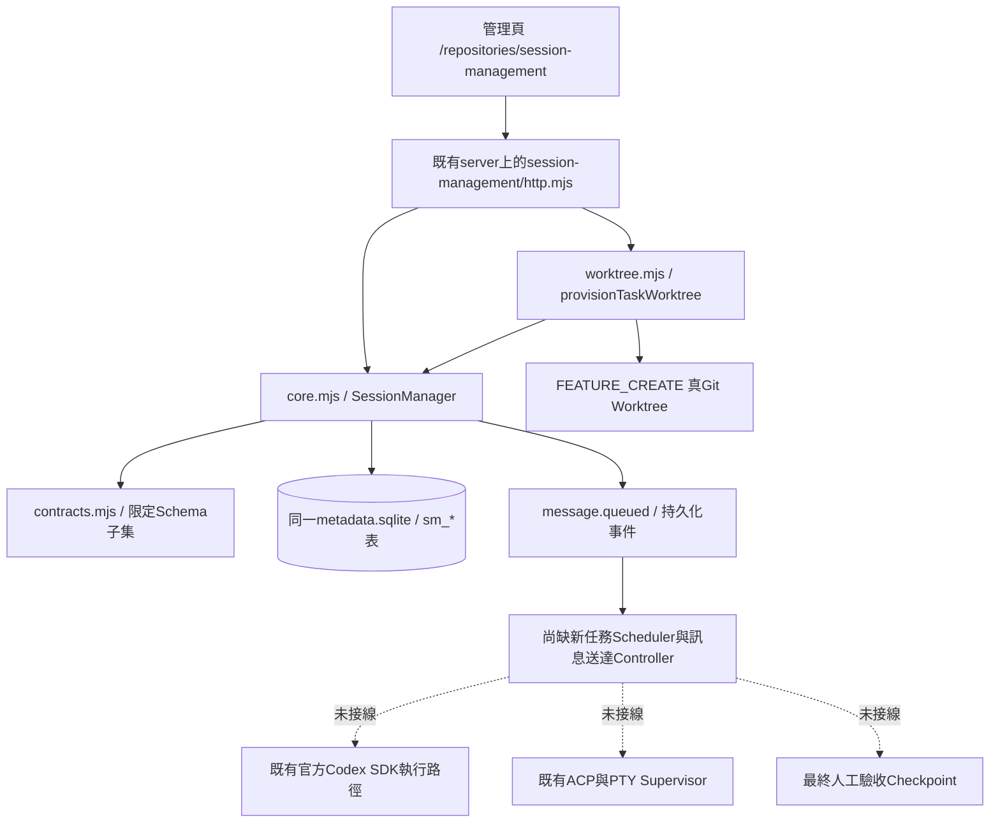
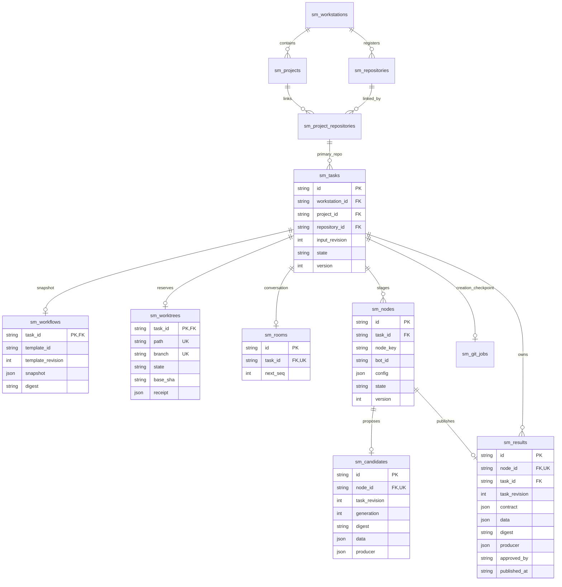
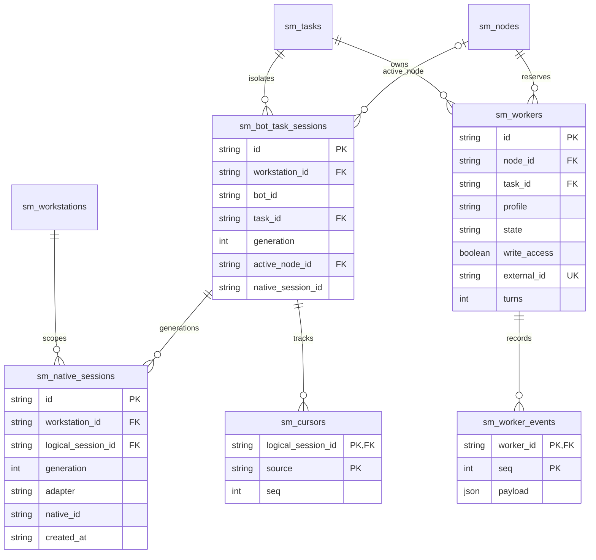
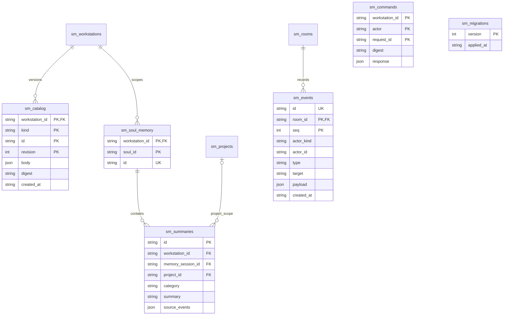
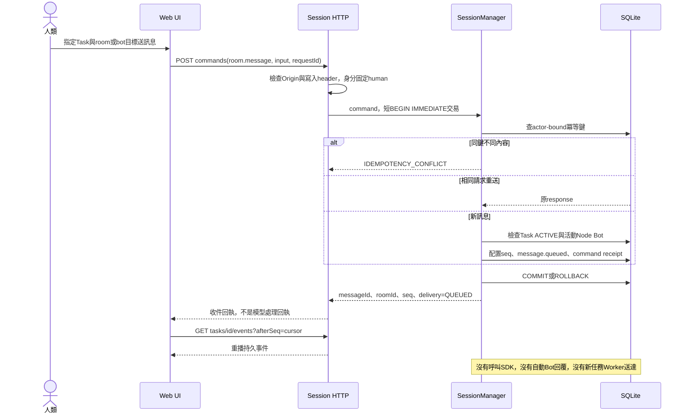
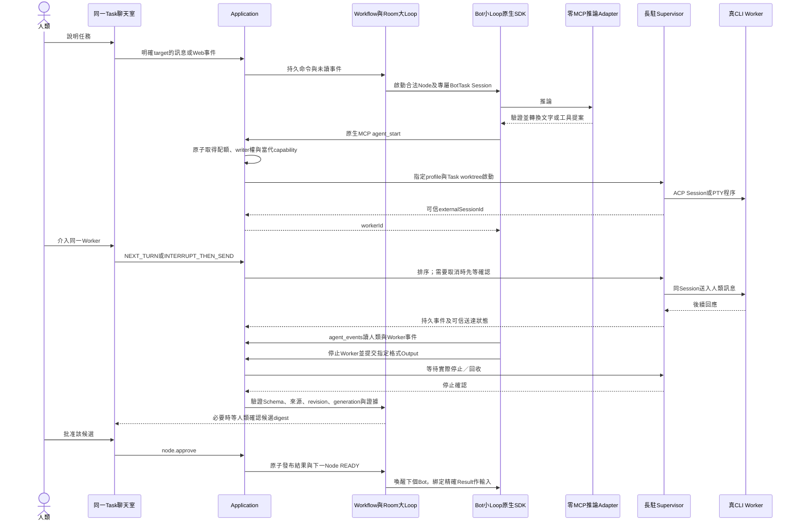
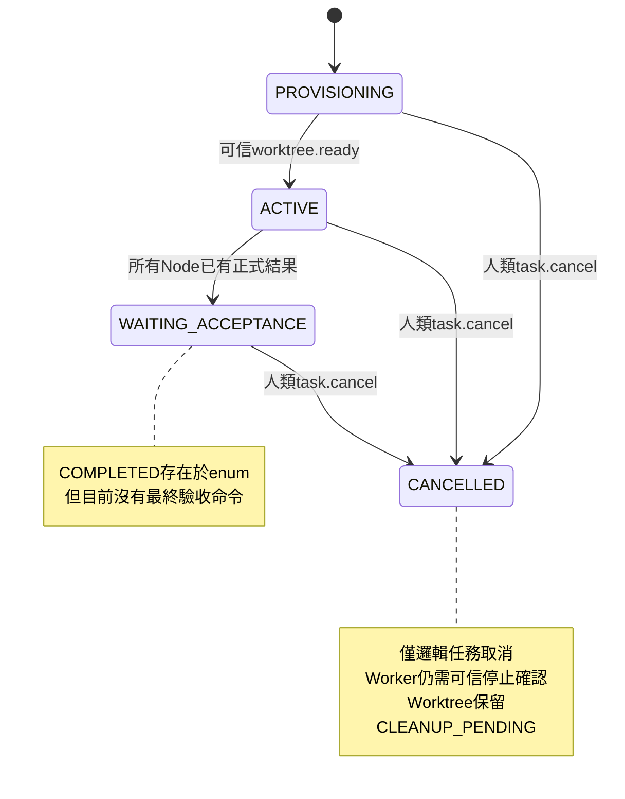

# Session Management v2：實作架構、物理 ERD 與整合缺口

**完整產品尚未實作完成。** 此文件核對產品 `f52081ccf4fddb5de6b0318b6fbeaae39b1b272a` 的實際程式，不把已合併 PR、資料庫收據或 fixture 當成真 SDK／模型／Worker 驗收。

規格來源：`REQ-WB-102/session-management`。完整概念架構、Session ERD、聊天室及人工介入循序、恢復與最終驗收設計見[配對 SD 補正](https://github.com/Xing00000/bdd-spec/blob/2600b016c39f8318341deefb2957e2a9ed06422c/spec/REQ-WB-102/session-management/session-management.sd.md)。原規格 PR #1 與產品 PR #6 已合併；本次是文件補正，不改產品行為、不啟用缺少的執行器。

## 1. 現況架構



HTTP 是既有 standalone／Fastify server 的路由，沒有第二個常態網站。`SessionManager` 在請求期間開啟資料庫後關閉；它是資料狀態核心，**不是長駐 Scheduler 或 CLI process owner**。

```json
{
  "nativeRuntimeDispatch": false,
  "workerDispatch": false,
  "acceptanceCheckpoint": false
}
```

以上旗標來自 `packages/workstation/session-management/http.mjs`，不是文件推測。現有獨立執行路徑的功能不能直接算成新 Task／Node 已完成接線。

## 2. 物理 ERD：對照實際 schema.sql

來源：[schema.sql](../../packages/workstation/session-management/schema.sql)。圖中欄位為重點摘要；完整型別、CHECK、複合鍵與 triggers 以 SQL 為準。ERD 的關聯表示實際 FK；JSON 內部引用另列，不捏造獨立表。

### 2.1 工作站、任務、Workflow、Worktree、結果



SQL 的 task_id PK／UNIQUE 保證最多一筆；`createTask()` 的同一交易才保證每個成功建立的 Task 恰有一個 Workflow、Room、Worktree 記錄及至少一個 Node。Worktree 記錄存在不代表實體建立成功，必須收到 provisioner 核對收據。

`sm_project_repositories` 的複合 FK 確保 Task 的 Repo 確實綁定所選 Project。`sm_nodes` 的 `UNIQUE(task_id,node_key)` 避免同任務重複階段。Node Bot、Goal、依賴、Output、CLI Policy 存在不可變 config；沒有另外一張 `node_dependencies` 表。

### 2.2 BotTask、原生 Session、來源游標與 Worker



實際唯一性與語意：

| 約束 | 用途 |
|---|---|
| `UNIQUE(workstation_id,bot_id,task_id)` | 一個 Bot 對一個 Task 的穩定邏輯 Session |
| `UNIQUE(logical_session_id,generation)` | 保留原生 Session 換代歷史 |
| `UNIQUE(workstation_id,adapter,native_id)` | 不把一個原生 Thread 綁給另一個 Task |
| `sm_bot_task_sessions.native_session_id` | 指向本地 `sm_native_sessions.id`，不是 SDK 的 native_id；目前不是 SQL FK |
| `sm_cursors(logical_session_id,source)` | `room` 與每個 `worker:<id>` 分開遞增 |
| `sm_one_workspace_writer` partial UNIQUE index | 同 Task 的 RESERVED／RUNNING／UNKNOWN 中只能有一個寫入者 |

Bot 與 Soul 都是版本化 catalog；SQL 沒有對 `bot_id` 建到 catalog JSON 的 FK。跨 Workstation、固定 revision、Task 與當前 generation 的有效性由核心檢查。Node → BotTask 的 active_node 是可空的目前綁定，不是所有權。

`sm_workers` 是配額／狀態紀錄，不等於一個程序。`external_id` 預留給既有 Supervisor Session；目前新任務未接線。`worker.receipt` 的 fixture 只能驗證資料轉移，不能證明程序真的停止。

### 2.3 Catalog、Soul 記憶、事件與命令回執



`sm_commands` 沒有 room/task FK；actor key 由受信任的 kind/id/task/node/generation 組成。`sm_migrations` 是獨立 additive ledger，不覆寫既有 `PRAGMA user_version`。

Catalog JSON 引用由 `validateCatalog()`、`freezeNode()` 驗證並凍結：

| kind | body 核心內容 |
|---|---|
| skill | name、instructions |
| soul | roleTags、thinkingStyle、avatarAssetId、skills 的 id/revision/config |
| bot | soul 引用、runtime、acpProfile 引用、model |
| profile | transport=acp、connectionRef；不是模型提供的任意命令 |
| workflow | nodes：key、bot、goal、dependsOn、output、cliPolicy、requiresHumanApproval |
| contract | name、受支援 Schema |

沒有獨立 `soul_role_tags`、`soul_skills` 或 `runtime_profiles` SQL 表；不能將概念 ERD 的 entity 直接當成 Migration 已存在。長期記憶的 `source_events` 也是 JSON，由程式核對來源與 Soul 參與任務，而非 SQL join table。

## 3. 現況聊天室循序



`participants` 由 READY／RUNNING／WAITING_HUMAN 的 Node 推導，不是獨立成員表。目前 `room.message` 不接受新任務的 `worker:<id>` target。`sm_events` 可讀回不等於已完成 SSE 推送／排程喚醒／已處理回執。

## 4. 目標聊天室與Worker循序：尚待接線



這條鏈路尚未存在於新 Task API。既有 Supervisor 是可重用元件，但還需要受 task/node/generation 限制的接線、名額對應與停止收據。SDK 回合終止不能成為 Worker 自動終止的理由。切換 Codex／Claude 也不能跨 SDK 使用對方原生 Session ID。

## 5. 狀態、結果與資料一致性

當前核心的主要路徑：



當前 Node：BLOCKED → READY → RUNNING → WAITING_HUMAN／SUCCEEDED。`node.start`、`runtime.attach`、`node.submit`、`worker.*` 是內部命令，人類 HTTP 不可偽造。FAILED 是 enum，不可因此假定已有完整失敗重試控制器。

`node.submit` 核對當前 Task、Node version、input revision、原生 Session generation、Output Schema，且禁止有 RESERVED／RUNNING／UNKNOWN Worker 時完成。需要人工確認時保存候選，否則發布。`node.approve` 綁定 candidateDigest 與 expectedVersion；節點批准不等於 Task 最終驗收。

`publish()` 在同一交易寫入不可變 `sm_results`、更新 Node、清除 active_node、追加 `result.published`、推導下游 READY。現況一個 Node 最多一個 candidate／result，尚無完整重試 Attempt 或需求修訂／重新規劃 API。下游取得精確依賴結果，不應解析聊天文字或猜 latest；通用 typed Input mapping 與可信測試證據仍待接線。

Output 驗證是閉合 JSON Schema 子集：明確 type、properties、required、items、長度／數量／數值界線、enum、const。未知 keyword、remote ref、組合式 Schema 與開放 object 在註冊時拒絕。不作 coercion；合法的 `accepted:false`／`verdict:FAIL` 不會變成產品通過。

命令使用短同步 `BEGIN IMMEDIATE`，禁止在交易內等待模型、Git、程序或測試。相同 actor-bound requestId 與 payload 回原收據；不同內容衝突。這只提供資料庫邊界冪等，不承諾外部 CLI 副作用 exactly-once。

## 6. 接線前必須處理的缺口

| 缺口 | 驗收門檻 |
|---|---|
| Root Room Scheduler／Node Runtime Controller | 真SDK事件、未讀訊息投遞、同任務序列化、無事件不空跑 |
| generation與恢復 | 同原生ID恢復需另定契約；現有runtime.attach會插入新紀錄且受nativeId唯一限制 |
| Worker quota到Supervisor | reservation與externalId對帳；未知程序不釋放名額；逾時與停止可靠回執 |
| 真互動與回執 | QUEUED、DELIVERED、PROCESSED、UNKNOWN分開；PTY寫入／靜默不能冒充完成 |
| 取消／完成競態 | 增加CANCEL_REQUESTED等需要Migration；停機與Writer終止確認後才宣告實際取消 |
| 可信Result與需求修訂 | 精確來源快照／測試證據、typed下游Input、新revision的舊結果失效 |
| Git最終驗收 | 人類批准綁定受測digest、checkpoint後才Task COMPLETED、失敗可對帳重試 |
| 可替換Runtime | Claude真Adapter、各Provider能力相容測試，不只設定enum |
| Memory／Avatar | 自動萃取／壓縮與圖片上傳尚未實作；目前只保存摘要及圖片引用 |
| 舊資料整合 | 既有chat／execution資料不自動改寫或映射；需要明確Migration |

目前沒有獨立 Outbox／Inbox／Runtime Turn／Message delivery ledger。新增這些表前必須先定義版本、消費者cursor與重送對帳契約；不可宣稱只靠sm_events就已有完整durable scheduler。

## 7. Memory、秘書與HTTP契約

Soul 的記憶是工作台邏輯 ID，不是常駐模型 Thread。`memory.summarize` 目前只接受人類，核對 Soul 曾參與來源任務、sourceEventIds 屬於所選 Project、分類與去重。單筆最多2,000字元，每scope最多200筆；不自動搬入原始對話、不自動驅逐舊摘要。跨專案共享需人類明確提升。摘要有來源不代表內容自動可信。

秘書 `portfolio()` 是不含對話與記憶原文的進度 projection，不是已實作的 Secretary Agent Loop。Role Tags 是職能，不是權限。

`POST /repository-api/v1/session-management/commands` 的人類白名單：

```text
project.create / repository.register / repository.link / catalog.save
task.create / task.cancel / room.message / memory.summarize / node.approve
```

範例：

```json
{"command":"project.create","input":{"name":"Example"},"requestId":"unique-command-id"}
```

要求 `X-Workbench-Request: 1` 並檢查 Origin；actor由HTTP邊界產生。此部署是private-loopback單人工作站，不是多使用者ACL。未來Bot MCP需由伺服器綁定task/node/generation與allowed operations，不能把內部command開成不受限RPC。

GET：根路由snapshot、`/portfolio`、`/tasks/:id`、`/tasks/:id/events?afterSeq=0&limit=200`、`/nodes/:id`、`/memory/:soulId?projectId=...`、`/capabilities`。`POST /tasks/:id/provision` 只明確重試Task建立。

## 8. Git邊界與崩潰安全

Repo註冊只核對local path，不執行Git。`provisionTaskWorktree` 在FEATURE_CREATE邊界、SQLite交易之外執行Git，固定HEAD、生成Task branch/path，核對common-dir／branch／SHA後才READY。關閉Git hooks不等於OS sandbox，也不能保證其他Git filter不執行；僅處理受信任Repo。

正常讀寫、聊天、記憶、換代與取消不執行Git。取消留CLEANUP_PENDING，不隱藏remove/reset/clean。失敗保留Task及原因；只能收養精確Repo／branch／固定SHA相符的既有目錄。RUNNING Git job租約過期不代表子程序已死，須人工／可信控制器對帳，不做破壞式清理。

嚴格禁止Worker自行Git需要OS與檔案權限隔離，Profile、Prompt或PATH wrapper不能單獨保證。新執行接線啟用前必須驗證這項界線。

## 9. 驗證與完成定義

核心測試入口（專案支援Node 24）：

```sh
node --test tests/workstation/session-management*.test.mjs
```

原核心測試使用真SQLite、HTTP socket、競爭的OS程序和暫存Repo內的真Git Worktree；原生Session及Controller收據是明確fixture。43項核心測試的歷史通過紀錄，不可取代全量回歸或新任務真模型E2E。歷史CI紀錄見[產品PR #6](https://github.com/Xing00000/bdd/pull/6)，曾有全量workstation與瀏覽器失敗，不得因文件修正宣稱已修復。

本次文件補正只核對上述程式／SQL及圖文關係，未重跑產品測試、真SDK、模型、CLI Worker或瀏覽器。未將Mermaid實際渲染當成已驗證；需在文件審查時檢查渲染。配對SD變更不代簽review.json，不更換規格gitlink或歷史證據。

完成標準：真Web任務對話 → 真大Loop／小Loop → 受限原生MCP → 真互動Worker → 人類同Session介入 → 固定Output與可信證據 → SA／SD等下一節點 → 最終人工驗收Git checkpoint，並通過重啟、取消、並發、跨Task隔離與失聯對帳測試。**本版管理核心尚未達成此完成標準。**
