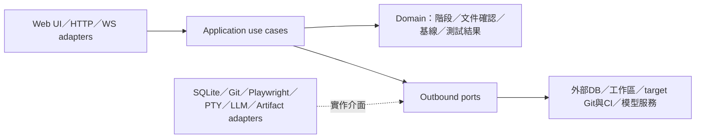
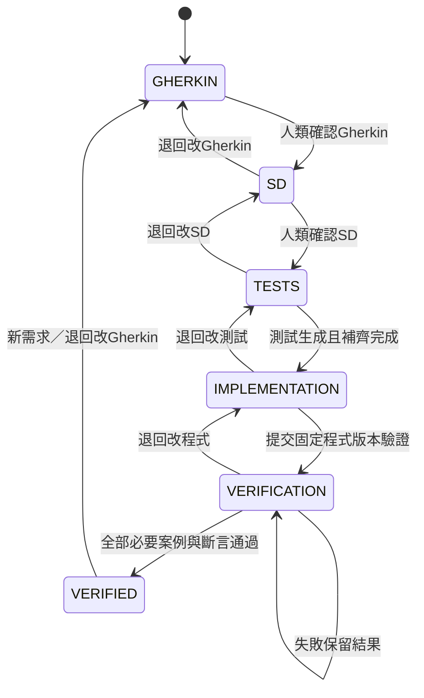

# SD：BDD 軟體開發工作台

版本：0.2（需求目錄整理）；日期：2026-10-17；狀態：**待使用者確認，尚未核准**。本文件只有設計，所有DDL／DML片段均未執行；沒有產生測試、安裝依賴或實作產品。

需求基準：[同次需求的 workbench.feature](workbench.feature)；原核准來源：[ef497e6 的 Gherkin](https://github.com/Xing00000/bdd/blob/ef497e666f27515716c2f33b812da7e71f846dc5/specs/workbench.feature)，20個Scenario／28個展開案例；SHA-256：`595d069841d51063fb155d09871d18d50b2da97700939deeb775f5fd931a5181`。本次不改feature，包括其中當時的待確認註解；目前階段以此次人類確認紀錄為準。

進入SD的依據：使用者於 **2026-10-17 03:53:13 UTC**，來源 `Sentinel_a38fb29dae588191ade4081426cdf3cc`，對上述交付表示：**「同意 產sd文ㄓㄧㄢ」**。這是Gherkin確認與產生SD的授權，**不是本SD核准**。本專案自身的feature、SD、確認紀錄及後續測試都保存在`Xing00000/bdd` Git；先前隔離的未核准稿不作本設計依據。

### 當次需求的文件歸屬

本次需求ID為`REQ-WB-001`。既有Scenario ID為`AC-WB-001`～`AC-WB-020`，全部保留，不重編、不改feature。跨檔追溯使用`需求ID / Scenario ID / case_id`，例如`REQ-WB-001 / AC-WB-009 / agent`；沒有Outline時case為default。`spec/`底下每個目錄代表一次需求，該需求的Gherkin與SD必須同目錄：`spec/REQ-WB-001/workbench.feature`、`spec/REQ-WB-001/SD.md`；`review.json`只記錄此需求的確認狀態與hash。其他需求使用各自目錄，不共用或覆寫這份SD。`doc/`只放ADR，不放各次需求的SD；目前沒有需要新增的ADR，因此不建立佔位文件。

本次文件遷移以`a16f142fc4d069c61fc33916468103ecbf8b02e1`為來源，路徑對照如下；文件提交／推送授權不代表SD內容已核准：

| 原Git路徑 | 目前本地路徑 |
|---|---|
| `specs/workbench.feature` | `spec/REQ-WB-001/workbench.feature` |
| `docs/SD.md` | `spec/REQ-WB-001/SD.md` |
| `specs/reviews/gherkin-review.json` | `spec/REQ-WB-001/review.json` |

原核准commit與feature hash繼續指向同一組位元組；目錄搬移不改驗收內容，也不代表SD已核准。SD綁定同目錄Gherkin的內容hash，不能變成獨立全專案設計文件。這個目錄規則也決定需求文件落Git時的位置，不建立第二份可編輯來源。

需求ID與發佈ID分開：一次release可包含多個需求，一個需求也可能分次release，因此不是一對一關係。本次只定義需求／情境到release的追溯語意，未配置release ID、未新增release管理功能，也未執行發佈。

## 1. 範圍與技術決策

產品只做共用專案、集中文件、分階段開發、SQLite操作、PTY、Playwright觀看／錄製、LLM補測試／協助開發與E2E報告。被移除的工作台角色管理、audit、評論／衝突處理、額外審核、DB操作限制與人類互斥交接均不設計成MVP功能，也不留成隱藏必做項。

| 選擇 | 理由與取捨 |
|---|---|
| TypeScript、Node.js 24 LTS | 前後端共用資料型別；API與工具整合在同語言。實作時鎖定修補版，這次不安裝。 |
| React＋Vite；Fastify＋WebSocket | Web UI顯示文件、DB表格、瀏覽器畫布、terminal與報告；HTTP承載指令／查詢，WS承載畫格與terminal I/O。採模組化單體，避免先拆微服務。 |
| SQLite、`node:sqlite` | 工作台metadata與專案測試DB分開。`DatabaseSync`是同步API，DB adapter在獨立worker/process執行，不阻塞畫面與API事件迴圈；Node24文件仍標release candidate，需在後續實作確認相容性。[S1] |
| Playwright Test＋`playwright-bdd` | Gherkin、明確step definitions及fixtures組合後生成Playwright測試；選9.2.1為生成器設計基線，Playwright需支援公開Screencast API，後續鎖定相容版本。[S2][S3] |
| Playwright Screencast | `page.screencast.start({onFrame})`公開提供JPEG畫格；前端canvas觀看同一會話。自己接傳輸、操作與語意錄製；不聲稱已有實測效能。[S4] |
| xterm.js＋node-pty | 前端terminal呈現與後端PTY；node-pty不是沙箱，沿用雲端工作區已有的隔離／權限。[S5] |
| LLM Provider Port | 模型可替換；只按目前階段提出SD、測試或程式變更，不修改鎖定產物。 |

noVNC排除。Neko可作日後傳輸替代的簡短比較對象，不列為本次另做一套系統。現有雲端權限與隔離設定維持不變；執行環境不提供所需能力時adapter回報不可用，不能修改安全設定或假裝成功。

## 2. 六邊形架構與依賴方向



**程式依賴由外向內**：domain不import框架、SQLite、Playwright或provider SDK；application依賴domain及port介面；adapters實作port；composition root組裝依賴。上圖`P → X`表示執行時呼叫，不表示domain依賴外部套件。

| 層 | 內容 | 核心責任 |
|---|---|---|
| Domain | Project、Workflow、Document、Baseline、TestDefinition、Run、StepResult | 階段允許的產物、確認前置條件、退回及失效、真實測試結果；不處理HTTP或檔案傳輸。 |
| Application | SaveDocument、ConfirmGherkin、ConfirmSD、GenerateTests、CompleteTests、StartDevelopment、RunVerification、ReturnToStage | 串接domain與ports；所有人類／LLM／工具的寫入均先檢查目前階段。 |
| Inbound ports | 專案／文件／流程命令、DB操作、browser／terminal命令、run查詢 | UI與程式使用相同use case，不由UI按鈕單獨決定是否可改檔。 |
| Outbound ports | ProjectStore、ArtifactStore、Workspace、DbConnection、GitRepository、CiRunner、BrowserSession、Terminal、LlmProvider、TestGenerator、TestRunner | 以工作台資料型別傳遞內容與結果，外部SDK型別不滲入domain。 |
| Adapters | SQLite worker、Git CLI／CI、Playwright owner、Screencast／Canvas、PTY worker、模型API、檔案artifact store | 轉換協定、實際I/O、程序生命週期與錯誤；不能自行推進workflow。 |

後續程式可分為`domain/`、`application/`、`ports/`、`adapters/`及Web UI；這是依賴邊界，不要求每個模組成為獨立服務。同步DB、PTY與瀏覽器可用獨立程序承接，API仍是一個部署單元。HTTP／前端的選用依據為[Fastify官方文件](https://fastify.dev/docs/latest/Reference/Server/)與[Vite官方指南](https://vite.dev/guide/)，沒有在本次建立專案設定。

## 3. 產品內階段流程與產物鎖定



每個非初始狀態也可經`ReturnToStage`明確退回Gherkin、SD、測試或程式所屬階段；圖只列常見路徑。`VERIFIED`是本次執行完成狀態，仍屬verification/report結果，不新增人工審核關卡。

| 階段 | 可寫入／產出 | 鎖定內容 |
|---|---|---|
| GHERKIN | feature | 不產生SD、step／spec或產品程式 |
| SD | SD文件，含架構及DDL／DML | 已確認feature；不寫測試或產品程式 |
| TESTS | generator設定、明確steps／fixtures、spec.ts、測試資料初始計畫、LLM測試補齊 | feature、SD；不改產品程式 |
| IMPLEMENTATION | 產品程式及其開發輸出 | feature、SD、測試基線 |
| VERIFICATION／VERIFIED | 執行既定測試、截圖、結果與報告 | feature、SD、測試與程式基線 |

寫入不符階段時，API回`409 ARTIFACT_LOCKED_IN_STAGE`；UI顯示「此階段不可修改該產物」，原內容不變。LLM patch、Git export、檔案保存與PTY工作區輸出都經同一WritePolicy；允許改的檔案與上游基線分開，鎖定基線不作可寫工作目錄。不能只靠disabled按鈕保證鎖定。

每次確認固定文件SHA-256；開始開發固定測試bundle hash；提交驗證固定source commit／snapshot及測試hash。這些是階段基線，不新增協作版本審查UI。驗證時**執行既定fixture計畫來改測試DB屬於測試副作用**，不是修改測試／程式基線，故可支援AC-WB-017～020。

退回規則：改feature使SD、測試、程式對應關係及結果失效；改SD使測試與後續結果失效；改測試使程式驗證及結果失效；改程式使執行結果失效。既有檔案與歷史結果保留但標`invalid`，不當成新基線的有效產物。Gherkin／SD改後必須重新確認；其餘階段重新完成後依序前進，不自動跳關，也不另加G3／G4人工批准。

## 4. 三種測試與文件的權威來源

| 類型 | 權威來源與執行 |
|---|---|
| 被開發專案CI測試 `target_git` | spec／steps／fixtures／CI設定存該target repo；記repo、branch、commit、檔案路徑，由該repo CI執行。工作台只存引用與結果，不能成為另一個可編輯CI測試主檔。 |
| 使用者自建整合測試 `user_db` | test definition／必要step或fixture內容存工作台SQLite。執行匯出指定hash的bundle到runner；匯出是副本，不偷偷同步target Git。定義與run有關聯。 |
| 本工作台自身測試 `workbench_git` | 本repo的feature、SD、確認metadata、後續steps／spec及程式全部跟`Xing00000/bdd` Git。自身開發流程不依賴尚未建成的產品DB。 |

產品的每次需求各有一個workflow，Gherkin／SD以同一需求識別集中在專案供多人讀寫；落Git時位於同一個`spec/<需求識別>/`目錄，SD跟隨該次Gherkin而不是獨立放到`doc/`。為CI輸出的已確認文件快照是引用，不是第二個需求編輯入口。target CI結果同時記候選commit與實際tested commit，因PR CI可能測試merge commit；不能把舊commit的結果移用到新版本。[S6]

## 5. SQLite資料模型與DDL／DML

### 5.1 工作台DB與被測專案DB

`metadata.db`存共用專案、流程、集中Gherkin／SD、基線、使用者整合測試與run／證據索引。專案DB是另外一個SQLite檔，由`target_connections`指向；Web DB介面讀寫**該專案DB**，不是把metadata表當成業務測試資料。AC-WB-017～020只指被測專案的測試DB，沒有授權操作正式DB。

SQLite以TEXT id／UTC時間、INTEGER數值、TEXT JSON存儲；每connection啟用foreign keys。schema／資料瀏覽實際查`sqlite_schema`與表欄位，SQL以prepare/bind參數操作；識別字由schema選取後正確quote。下列是初版實體設計，**不建立migration檔、不執行SQL**。[S1][S7]

```sql
CREATE TABLE projects (
  id TEXT PRIMARY KEY NOT NULL,
  name TEXT NOT NULL,
  workspace_ref TEXT NOT NULL
);
CREATE TABLE workflows (
  id TEXT PRIMARY KEY NOT NULL,
  project_id TEXT NOT NULL REFERENCES projects(id),
  requirement_key TEXT NOT NULL,
  stage TEXT NOT NULL CHECK(stage IN ('GHERKIN','SD','TESTS','IMPLEMENTATION','VERIFICATION','VERIFIED')),
  current_test_baseline_id TEXT REFERENCES baselines(id),
  current_source_ref TEXT,
  UNIQUE(project_id, requirement_key)
);
CREATE TABLE documents (
  id TEXT PRIMARY KEY NOT NULL,
  workflow_id TEXT NOT NULL REFERENCES workflows(id),
  kind TEXT NOT NULL CHECK(kind IN ('gherkin','sd')),
  content TEXT NOT NULL,
  content_sha256 TEXT NOT NULL,
  confirmed_sha256 TEXT,
  confirmed_at TEXT,
  UNIQUE(workflow_id, kind)
);
CREATE TABLE baselines (
  id TEXT PRIMARY KEY NOT NULL,
  workflow_id TEXT NOT NULL REFERENCES workflows(id),
  kind TEXT NOT NULL CHECK(kind IN ('gherkin','sd','tests','source')),
  content_or_refs_json TEXT NOT NULL,
  sha256 TEXT NOT NULL,
  valid INTEGER NOT NULL CHECK(valid IN (0,1))
);
CREATE TABLE target_connections (
  id TEXT PRIMARY KEY NOT NULL,
  project_id TEXT NOT NULL REFERENCES projects(id),
  sqlite_file_ref TEXT NOT NULL,
  environment_label TEXT NOT NULL,
  app_base_url TEXT
);
CREATE TABLE repository_tests (
  id TEXT PRIMARY KEY NOT NULL,
  project_id TEXT NOT NULL REFERENCES projects(id),
  origin TEXT NOT NULL CHECK(origin IN ('target_git','workbench_git')),
  repository_url TEXT NOT NULL,
  branch_ref TEXT NOT NULL,
  commit_sha TEXT NOT NULL,
  test_paths_json TEXT NOT NULL
);
CREATE TABLE integration_tests (
  id TEXT PRIMARY KEY NOT NULL,
  project_id TEXT NOT NULL REFERENCES projects(id),
  owner_ref TEXT NOT NULL,
  name TEXT NOT NULL,
  definition_json TEXT NOT NULL,
  definition_sha256 TEXT NOT NULL,
  connection_id TEXT NOT NULL REFERENCES target_connections(id)
);
CREATE TABLE runs (
  id TEXT PRIMARY KEY NOT NULL,
  workflow_id TEXT NOT NULL REFERENCES workflows(id),
  origin TEXT NOT NULL CHECK(origin IN ('target_git','user_db','workbench_git')),
  repository_test_id TEXT REFERENCES repository_tests(id),
  integration_test_id TEXT REFERENCES integration_tests(id),
  test_baseline_id TEXT NOT NULL REFERENCES baselines(id),
  source_ref TEXT NOT NULL,
  environment_snapshot_json TEXT NOT NULL,
  definition_snapshot_json TEXT NOT NULL,
  status TEXT NOT NULL CHECK(status IN ('NOT_RUN','RUNNING','PASSED','FAILED','INCOMPLETE','INVALID')),
  CHECK((origin='user_db' AND integration_test_id IS NOT NULL AND repository_test_id IS NULL)
     OR (origin IN ('target_git','workbench_git') AND repository_test_id IS NOT NULL AND integration_test_id IS NULL))
);
CREATE TABLE case_results (
  id TEXT PRIMARY KEY NOT NULL,
  run_id TEXT NOT NULL REFERENCES runs(id),
  scenario_id TEXT NOT NULL,
  example_case_id TEXT NOT NULL,
  status TEXT NOT NULL CHECK(status IN ('NOT_RUN','RUNNING','PASSED','FAILED','INCOMPLETE','INVALID')),
  UNIQUE(run_id, scenario_id, example_case_id)
);
CREATE TABLE step_results (
  id TEXT PRIMARY KEY NOT NULL,
  case_result_id TEXT NOT NULL REFERENCES case_results(id),
  source_step_ref TEXT NOT NULL,
  action_index INTEGER NOT NULL,
  expected_json TEXT,
  actual_json TEXT,
  status TEXT NOT NULL CHECK(status IN ('NOT_RUN','RUNNING','PASSED','FAILED','INCOMPLETE','INVALID')),
  error_text TEXT
);
CREATE TABLE screenshots (
  id TEXT PRIMARY KEY NOT NULL,
  step_result_id TEXT NOT NULL REFERENCES step_results(id),
  moment TEXT NOT NULL CHECK(moment IN ('precondition','after_action','after_assertion','failure')),
  artifact_ref TEXT NOT NULL,
  sha256 TEXT NOT NULL
);
```

關聯：Project有多個workflow（每個代表一次需求）、DB connection及測試引用；`requirement_key`在同專案唯一，Git目錄為`spec/<requirement_key>/`。workflow有同次需求的Gherkin／SD兩份文件與基線，`documents.workflow_id`與`UNIQUE(workflow_id, kind)`維持這個綁定；run固定測試基線和定義快照；case→step/action→screenshots。`owner_ref`只識別自建測試作者，不代表新增工作台角色／ACL功能。`definition_json`包含自建整合測試的spec、必要step／fixture檔案、案例映射及初始資料計畫；Git測試的內容不放在此表。

`current_test_baseline_id`由application檢查屬於同workflow且kind為tests；其他跨表project／origin一致性也在use case檢查。初版不做通用文件歷史管理；baseline快照只是鎖定／失效所需的流程資料。圖片bytes保存在artifact目錄，DB只存引用與hash。

metadata確認與階段更新須同一transaction；示意DML：

```sql
BEGIN;
UPDATE documents SET confirmed_sha256 = content_sha256, confirmed_at = :utc_now
 WHERE id = :document_id AND kind = 'gherkin';
UPDATE workflows SET stage = 'SD' WHERE id = :workflow_id AND stage = 'GHERKIN';
COMMIT;
```

實作時必須先由domain驗文件／workflow相符、內容hash及目前階段；更新行數不符合就ROLLBACK。退回時在同一transaction更新stage、清除受影響確認、將下游baseline標`valid=0`與相關run標`INVALID`。不把上述SQL片段當成可直接繞過use case的公開介面。

### 5.2 被測專案DDL／DML與重跑初始狀態

以下只是AC-WB-017～020的**示例被測網站fixture**，不是工作台使用者／角色表，也不宣稱符合任意現有專案schema。測試生成階段將欄位映射到實際target schema。

```sql
CREATE TABLE test_accounts (
  username TEXT PRIMARY KEY NOT NULL,
  role_code TEXT NOT NULL,
  state TEXT NOT NULL
);
CREATE TABLE test_documents (
  document_key TEXT PRIMARY KEY NOT NULL,
  content TEXT NOT NULL
);
-- 初始化／重跑前置，值以prepared statement綁定：
INSERT INTO test_accounts(username,role_code,state)
 VALUES ('scenario_user','A','active')
 ON CONFLICT(username) DO UPDATE SET role_code='A', state='active';
INSERT INTO test_documents(document_key,content)
 VALUES ('scenario_document','initial')
 ON CONFLICT(document_key) DO UPDATE SET content='initial';
-- 模擬情境內的測試資料變更：
UPDATE test_accounts SET role_code=:role_b WHERE username=:username;
SELECT role_code,state FROM test_accounts WHERE username=:username;
SELECT content FROM test_documents WHERE document_key=:document_key;
```

角色A／B的真正可見與可操作規則由被測網站fixture提供：A只閱讀文件，B可編輯文件但不能管理帳號。只改DB欄位不證明權限已生效，必須退出舊登入並重新登入後做允許／拒絕的UI斷言。

DDL／DML由網頁DB介面提交給DbConnection adapter實際執行；完成後重新query並更新畫面，spec從畫面內容斷言實際資料，不以「送出成功」toast取代資料驗證。測試用初始化SQL／欄位映射與測試一起在TESTS階段固定，VERIFICATION只執行它，不臨時改測試內容。一般DDL／DML用SQLite transaction處理，錯誤ROLLBACK；不能假設VACUUM等所有命令皆可放交易。[S7]

現有target schema異動須列在該次SD的SQL片段，不能把本fixture的建表直接套到未知專案。新metadata DB建表屬後續實作；本次沒有實際migration、備份或DB變更動作。

## 6. 核心API、事件與資料流

API是application use case的adapter，以下路徑為設計契約。文件／測試／程式寫入都必須回到第3節的階段檢查；DB情境執行不另新增一層人工批准。

| API／通道 | 輸入 → 結果 |
|---|---|
| `GET/POST /projects` | 共用專案清單／名稱與workspaceRef → project |
| `GET/PUT /workflows/{id}/documents/{kind}` | gherkin或sd內容 → 目前集中內容／hash；錯階段拒絕保存 |
| `POST /workflows/{id}/confirm/{kind}` | 精確document hash → 確認與下一階段 |
| `POST /workflows/{id}/return` | 要改的gherkin／sd／tests／source → 對應階段與下游invalid狀態 |
| `POST /workflows/{id}/generate-tests` | 確認文件與origin → 生成job／test bundle／case mapping |
| `POST /workflows/{id}/complete-tests` | bundle與LLM提案 → 補齊結果或待補問題；只改TESTS產物 |
| `POST /workflows/{id}/start-development` | 已補齊bundle → 固定測試基線、IMPLEMENTATION |
| `POST /workflows/{id}/develop` | 開發任務與workspaceRef → LLM程式提案／執行輸出；只改程式 |
| `POST /connections`、`GET /connections/{id}/schema` | project與測試SQLite fileRef → 實際連線與schema |
| `POST /connections/{id}/sql` | SQL與params → columns／rows或changes；SELECT與DDL/DML皆為真實操作 |
| `GET/PUT /integration-tests/{id}` | SQLite內的定義、環境、作者 → 定義hash；依目前測試階段保存 |
| `POST /repository-tests` | target repo／branch／commit／paths → Git權威來源引用 |
| `POST /terminals`、`WS /terminals/{id}` | workspaceRef，input／resize／close ↔ PTY output／exit |
| `POST /browser-sessions`、`WS /browser-sessions/{id}` | managed會話、pageId、操作 ↔ 畫格／page狀態／操作結果 |
| `POST /browser-sessions/{id}/recordings` | 開始／停止、操作／locator／assertion → 語意動作草稿及TypeScript草稿 |
| `POST /workflows/{id}/verify` | 測試基線、sourceRef、environment → run與VERIFICATION |
| `GET /runs/{id}/report`、`GET /screenshots/{id}` | run／step引用 → 報告或實際圖片 |
| `POST /ci-results` | repo／testedCommit／CI run引用與附件 → 對應結果，不改Git測試定義 |

事件只供UI及工作程序交換狀態，不增加audit功能：`workflow.stageChanged`、`artifact.invalidated`、`document.saved/confirmed`、`test.bundleGenerated`、`llm.needsInput/completed`、`db.executed`、`terminal.output/exited`、`browser.frame`、`recording.draftReady`、`run.stepFinished/completed`。基本封套為`{eventId, projectId, workflowId?, runId?, scenarioId?, stepId?, type, payload}`。

主要資料流：

1. 人類保存feature → domain確認 → 產生／編輯SD → 人類確認 → generator讀兩個基準產spec與manifest。
2. LLM在TESTS階段補steps、fixtures與斷言 → 固定測試bundle → 開發人類／agent修改程式 → 固定sourceRef。
3. verifier執行該bundle；UI操作經Playwright、DB頁經DbConnection adapter讀寫測試DB；每步結果與截圖寫artifact store及結果表。
4. target CI可在target repo完成相同測試；工作台讀回其commit／run結果。DB整合測試則從DB快照匯出到runner。
5. reporter對應manifest與實際結果，形成報告；需要改內容時先ReturnToStage，不在VERIFICATION直接補測試或修程式。

## 7. 瀏覽器觀看、網頁錄製與PTY

### 同一個被操作的瀏覽器

BrowserSession adapter為每個工作區／run建立managed browser context；agent及程式的Playwright fixture使用該context與pages，觀看端訂閱它的page，而不是另外開一個相同URL的瀏覽器。需要區分`sessionId/contextRef/pageId`，程式本來自行開啟的外部browser不會自動變成此會話；接入managed fixture是必要整合契約。

Screencast adapter訂閱當前page的公開`onFrame`，WS送JPEG與`pageId/timestamp/viewportWidth/viewportHeight`，canvas顯示最近畫格。前端能選目前看的page，並標示連線是否仍更新；BrowserContext本身不是可嵌入畫面。畫格保留最新，避免慢觀看端積壓。`fps`選項屬影片輸出，不當成stream callback速率保證；tracing／video可能影響畫格尺寸。沒有本產品效能實測或FPS／延遲承諾。[S4]

供測試使用的DB頁面直接呈現SQL編輯／資料結果，不在自己的DB畫面中再次嵌入自身viewer，避免畫面遞迴。目標網站在managed browser執行，不用iframe宣稱能裝任意網站；事後Trace Viewer只能作補充證據，不取代即時觀看。[S8]

### 自有語意錄製

人類從網頁viewer操作並在locator／assertion編輯器選擇預期。操作送BrowserSession adapter，透過公開Playwright API執行；錄製器記`navigate/click/fill/select/assertVisible/assertText`等action、page、locator與expected值，使用相同action模型產TypeScript草稿。座標點擊必須換算canvas縮放與實際viewport；保存成測試前由人類確認locator，不把畫面座標當成穩定定位器。

優先使用role／text／testId定位器，公開`pickLocator()`可輔助選取，但其整合需在後續測試階段驗證。不能可靠識別的操作留明確待補內容。錄製草稿只在TESTS階段成為測試變更；其他階段可觀看，若要修改鎖定測試就退回TESTS，不從錄製內容覆寫feature。

官方`playwright codegen`是browser＋Inspector桌面錄製流程，不是可直接嵌入的穩定網頁recorder SDK；Screencast也不自帶錄製／輸入功能。本設計不依賴未公開的recorder API。[S8]

### PTY與生命週期

xterm.js顯示node-pty的真實I/O；Terminal adapter以workspaceRef啟動shell／專案程式，處理input、resize、output及exit。執行用該階段的工作目錄與第3節基線邊界，不讓terminal保存時繞過產物鎖定。程序在既有工作區權限內執行，不把宿主任意shell直連成新公網服務。[S5]

開啟workspace後才建立terminal／browser；停止時關閉PTY程序、context及錄製，保存已產生的結果，失敗或未完成就保留實際狀態。此處不新增閒置配額、控制權租約或交接功能。

## 8. Gherkin到spec.ts、LLM與測試基線

生成契約是`已確認feature + SD + 明確step映射/fixtures + 固定generator版本 → spec.ts + case/step manifest`。Gherkin只定義行為，不自動提供網站定位器、資料欄位或業務斷言；後續TESTS階段必須逐步定義。

選用`playwright-bdd`的`defineBddConfig`與`createBdd`，使用具體Cucumber expressions／typed參數，`missingSteps: fail-on-gen`。未定義步驟阻擋生成，已定義但未實作步驟拋明確錯誤；不用空函式、catch-all、skip來假通過。Scenario ID來自`@AC-WB-xxx`，Outline用`case_id`，Background及每一步保留feature位置；本基準預期20個Scenario／28個展開案例。[S2]

**副檔名的真實限制**：鎖定設計基線的bddgen9.2.1原生輸出`.feature.spec.js`。[S3] 後續建立最小TS轉接：同路徑深度改成`.spec.ts`，只補生成metadata所需型別資訊，保留source mapping行號，並以TypeScript型別擦除後的JavaScript相等檢查證明沒有改測試行為。若鎖定版格式不同就停止調整；不能稱為bddgen原生TS輸出。本次不建立轉接程式，也不把隔離的舊工具鏈搬回來。

LLM輸入為確認文件、步驟清單、目標網站／schema及現有測試上下文；輸出對應slot的step、locator、assertion及fixture提案，或`needs_input`。它不能改已確認feature／SD或刪案例。TESTS階段補完且不存在未實作步驟後固定bundle；IMPLEMENTATION階段LLM只提出產品程式變更，遇到測試或需求錯誤先請求退回對應階段。

Provider介面保持`generateSd(context)`、`completeTests(context)`、`proposeImplementation(context)`三個用途；傳回`{files/patches, questions, usage}`，application按目前階段保存，不直接把模型文字當shell或測試結果。模型供應商未綁死，不在本次新增帳號／provider管理系統。

## 9. 透過網頁DB模擬人類端到端測試

每個run使用命名的`dbPage`與`appPage`，前者是工作台Web DB介面，後者是被測網站；都由Playwright實際操作。Web DB頁要有穩定label／testId供查詢、保存及結果讀取，不能為了讓E2E通過改成直接用Node SQL跳過此頁。

| 情境／時點 | spec實際操作及斷言 | 截圖與結果 |
|---|---|---|
| AC-WB-017 前置／查詢 | 打開測試DB頁，查`scenario_user`；斷言實際role=A、state=active | 初始資料畫面、每個查詢操作與斷言；scenario／step對應 |
| AC-WB-018 DB變更 | DB頁把A改B並保存，再查回B；不能只斷言toast | 保存後及重新查詢／斷言的DB畫面 |
| AC-WB-018 重新登入 | appPage退出舊登入，再登入同帳號，檢查B的編輯入口 | 登出／登入操作及登入後的畫面 |
| AC-WB-018 允許／拒絕 | 改文件為edited，斷言成功，再於DB頁查回內容；打開管理帳號頁，斷言拒絕且帳號資料未改 | 每個主要操作與斷言畫面，以及其實際觀察值 |
| AC-WB-019 失敗 | 網頁或DB資料不符expected時保留原assertion失敗 | 失敗當下頁面、expected、actual、錯誤與對應step；截圖成功不會改為PASS |
| AC-WB-020 重跑 | 先用DB頁還原A／active與文件initial，結束舊登入；查回確認後再走同一情境 | 本次初始狀態及其斷言畫面，不沿用上一run的edited／B狀態 |

拒絕帳號管理操作的資料斷言，比較「已改成B後、拒絕操作前」與「拒絕操作後」的帳號資料，保留合法的A→B變更；不拿A初始狀態誤判B變更。測試前置資料計畫與每個case綁定，需明確定義`scenario_user`、`scenario_document`及初始值；同一case重跑時重新建立這些值。這是核心可重跑行為，不新增資料管理或工作台角色功能。權限規則屬被測網站，需對該網站的真實UI及資料結果斷言。

截圖策略：每個Playwright操作及assertion透過同一測試driver執行，使用`scenarioId/caseId/stepId/actionIndex`記錄子操作。操作／斷言後呼叫`page.screenshot()`並附到該step；前置確認另標`precondition`，錯誤時在failure handler先截當前頁再保留原錯誤。fixture／driver是後續測試階段的產物，本次只有契約。Playwright screenshot與`testInfo.attach`可提供實際圖片附件。[S9]

driver不決定測試是否成功，`expect`／資料斷言才決定。缺少實際斷言、step未執行、必要截圖未保存或執行未結束時，報告不能填PASSED；截圖取得失敗也不能吞掉原測試失敗。每個run的圖片名稱／引用獨立，不覆蓋前次run。

## 10. E2E報告與後續驗證

報告從run／case／step／screenshots及CI結果組成，至少包含：來源類型、target repo／commit或DB test定義hash、feature／SD／test基線、環境、每Scenario／Examples case、step預期與實際結果、截圖、錯誤及整體狀態。三種測試來源分開呈現，不能把target CI成功當成DB整合測試已執行。

`PASSED`必須有本次固定版本的完整案例結果，必要步驟及實際斷言全部通過；0個案例、缺step／缺案例、空函式、只截圖或未執行都不是通過。失敗為FAILED，資料／證據不完整為INCOMPLETE，退回改上游後原結果為INVALID。沒有本次產品執行就NOT_RUN。先保存實際結果再產生HTML／JSON；不能用LLM的成功文字或HTML顏色當結論。

**以下驗證都待SD確認後依階段進行，本次未執行：**

| 階段 | 驗證內容與完成依據 |
|---|---|
| TESTS | 建立generator／明確steps／fixtures；官方parser可解析；20／28映射完整；真實生成`.spec.ts`、TypeScript檢查與Playwright discovery；缺step確實阻擋。以上不是E2E通過。 |
| IMPLEMENTATION | 依六邊形邊界實作：domain階段／失效規則、SQLite真實持久化與SQL結果、API／UI、Git／LLM／PTY／browser adapters；用已固定測試驗證，不同時改規格與測試。 |
| VERIFICATION | 固定程式與測試基線，走共用專案、文件確認、DB／PTY／browser／錄製、Git與DB測試來源、AC-WB-017～020的真實UI與資料流程，產生逐步截圖及報告。故意造成expected不符應得到失敗結果。 |

### 需求覆蓋檢查

| Gherkin | 對應設計 |
|---|---|
| AC-WB-001 | 本文件開頭的Git自舉及確認來源；第3／4節 |
| AC-WB-002 | 第2節共用專案／集中文件use case；第5／6節 |
| AC-WB-003、AC-WB-004、AC-WB-005、AC-WB-006 | 第3節階段；第6／8節文件→生成→LLM→開發 |
| AC-WB-007、AC-WB-008 | 第5／6節SQLite真實操作；第7節PTY |
| AC-WB-009、AC-WB-010 | 第7節同會話觀看與自有網頁錄製 |
| AC-WB-011、AC-WB-012 | 第4／5節Git CI與SQLite整合測試的權威來源 |
| AC-WB-013、AC-WB-014 | 第8／10節缺步驟與實際結果；第9節截圖／斷言 |
| AC-WB-015、AC-WB-016 | 第3節產物鎖定、可觀察拒絕、退回與下游失效 |
| AC-WB-017、AC-WB-018、AC-WB-019、AC-WB-020 | 第5.2節fixture／SQL及第9節逐步人類測試流程 |

## 11. 需使用者確認的設計選擇

這些是feature未指定的實作決策，沒有擅改feature：

1. 是否接受Node24內建`node:sqlite`作為SQLite adapter（目前為release candidate），以及React／Fastify／Screencast的組合。
2. agent與程式經managed Playwright fixture接入同一可觀看context；網頁錄製採自有action／locator／assertion介面，而不是嵌入官方桌面Inspector。
3. 自建DB測試以bundle JSON存SQLite，Git CI只存Git引用；測試資料fixture的實際欄位及被測網站登入／角色規則在TESTS階段映射，不把本文件示例表當未知專案的既有schema。

SD確認後才進入test generation/completion；此交付不代表任何功能已實作、SQL已執行、生成成功或E2E通過。

## 官方依據（2026-10-17查核）

- **S1** [Node24 SQLite文件](https://github.com/nodejs/node/blob/v24.19.0/doc/api/sqlite.md)：`DatabaseSync`同步API及release candidate狀態；[Node.js版本](https://nodejs.org/en/about/previous-releases)。
- **S2** [playwright-bdd設定](https://github.com/vitalets/playwright-bdd/blob/v9.2.1/docs/configuration/options.md)、[step／fixture寫法](https://github.com/vitalets/playwright-bdd/blob/v9.2.1/docs/writing-steps/playwright-style.md)。
- **S3** [bddgen生成路徑原始碼](https://github.com/vitalets/playwright-bdd/blob/v9.2.1/src/generate/paths.ts)：原生`.spec.js`輸出。
- **S4** [Playwright Screencast](https://playwright.dev/docs/api/class-screencast#screencast-start)：公開`onFrame`、viewport／尺寸與影片選項界線。
- **S5** [node-pty](https://github.com/microsoft/node-pty)、[xterm.js](https://xtermjs.org/docs/)：PTY與terminal呈現；node-pty繼承parent權限。
- **S6** [GitHub Actions變數](https://docs.github.com/en/actions/reference/workflows-and-actions/variables)：branch、commit與CI run識別。
- **S7** [SQLite CREATE TABLE](https://sqlite.org/lang_createtable.html)、[Transaction](https://sqlite.org/lang_transaction.html)、[VACUUM](https://sqlite.org/lang_vacuum.html)：資料型別／鍵與SQL交易差異。
- **S8** [Playwright codegen](https://playwright.dev/docs/codegen)、[Trace Viewer](https://playwright.dev/docs/trace-viewer)、[pickLocator](https://playwright.dev/docs/api/class-page#page-pick-locator)：桌面錄製、證據分析與locator能力分清。
- **S9** [Playwright screenshot](https://playwright.dev/docs/api/class-page#page-screenshot)、[testInfo.attach](https://playwright.dev/docs/api/class-testinfo#test-info-attach)：實際截圖及報告附件。
